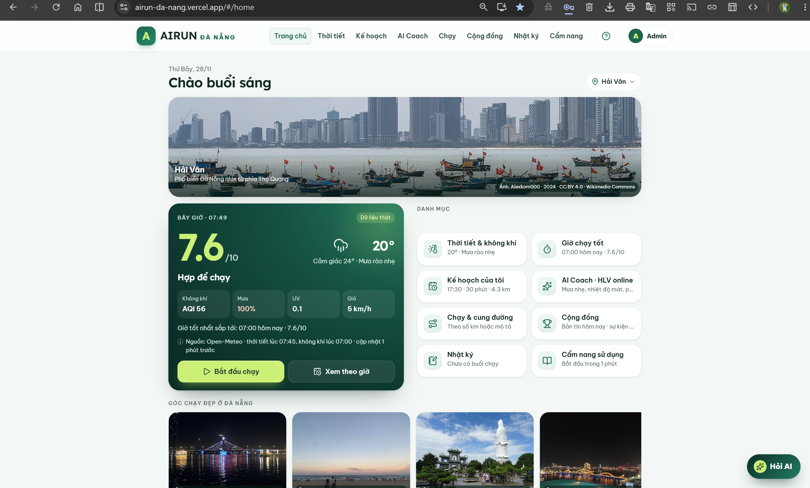
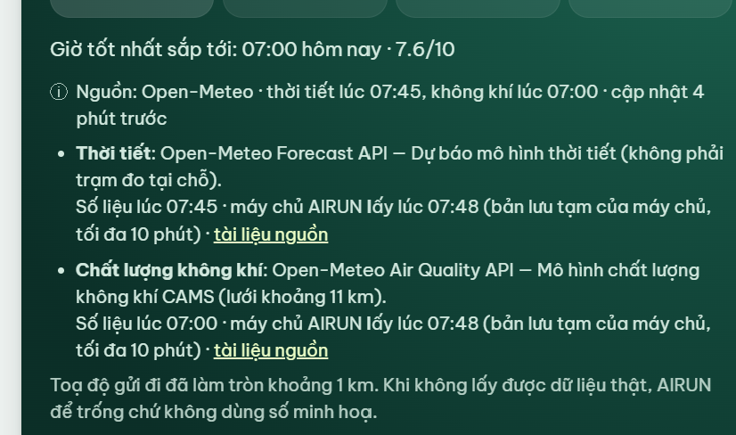
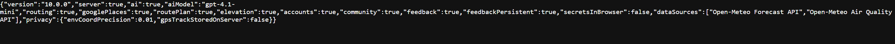
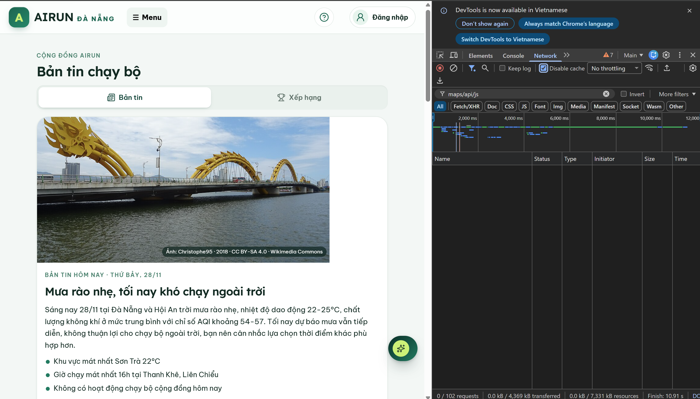
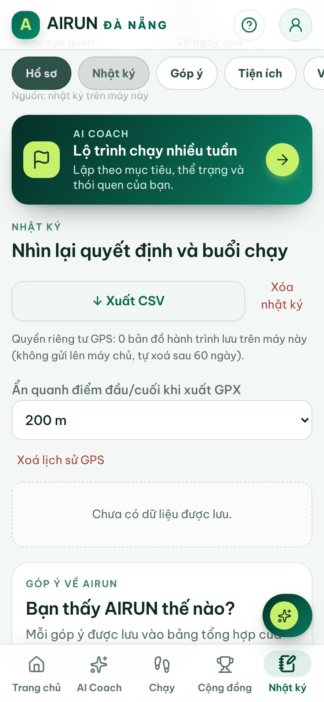

# Minh chứng cải tiến — Chặng 2 vòng Chung kết

**Đội AIRUN · Bảng B · Sản phẩm:** https://airun-da-nang.vercel.app · **Mã nguồn:** https://github.com/Ndinhtoan21/AIRUN_V41_FIXED_FONTS_IMAGES

**Đề (Yêu cầu cải tiến 1 — Đảm bảo dữ liệu thật và an toàn truy cập)**
- Vấn đề: cần phân biệt dữ liệu thời tiết thực với dữ liệu minh họa; thông tin truy cập dịch vụ bản đồ đang có thể bị lộ từ phía trình duyệt.
- Yêu cầu: rà soát nguồn và thời điểm cập nhật dữ liệu; bảo vệ thông tin bí mật ở máy chủ, hạn chế chia sẻ tọa độ/lịch sử GPS.
- Minh chứng: demo dữ liệu có thời gian cập nhật và xác nhận không lộ khóa bí mật trong giao diện/mã trình duyệt.

**Phiên bản đã nộp:** V10.0 (commit [`a7a6e0b`](https://github.com/Ndinhtoan21/AIRUN_V41_FIXED_FONTS_IMAGES/commit/a7a6e0b)) và V10.0.1 (commit [`caeb7df`](https://github.com/Ndinhtoan21/AIRUN_V41_FIXED_FONTS_IMAGES/commit/caeb7df)), triển khai tự động lên Vercel sáng 28/11/2026. So sánh toàn bộ thay đổi với bản trước chặng: [V9.9.1 → V10](https://github.com/Ndinhtoan21/AIRUN_V41_FIXED_FONTS_IMAGES/compare/73411c8...main). Ghi chú thay đổi: [`CHANGELOG_V10.md`](../CHANGELOG_V10.md).

---

## 1. Demo dữ liệu có nguồn và thời gian cập nhật (trang thật, 28/11/2026)

Thẻ "Bây giờ" ghi nhãn **"Dữ liệu thật"** và dòng **"Nguồn: Open-Meteo · thời tiết lúc 07:45, không khí lúc 07:00 · cập nhật 1 phút trước"**. Thời tiết và không khí có giờ khác nhau vì Open-Meteo cập nhật thời tiết 15 phút/lần, không khí 1 giờ/lần — AIRUN ghi đúng giờ của từng nguồn.

Nguồn và giờ cũng hiện ở trang Thời tiết, trang Kế hoạch, và được gửi kèm cho AI Coach để AI nói rõ số liệu lúc mấy giờ. Bấm vào dòng nguồn để xem chi tiết: loại dữ liệu (dự báo mô hình, không phải trạm đo tại chỗ), giờ của số liệu, giờ máy chủ AIRUN lấy về, bản lưu tạm của máy chủ (tối đa 10 phút), liên kết tài liệu nguồn và cam kết **không dùng số minh họa**.

Cách tự kiểm tra: mở https://airun-da-nang.vercel.app/api/weather/16.06/108.22 — cuối kết quả có khối `_meta` gồm `source`, `observedAt` (giờ số liệu), `fetchedAt` (giờ máy chủ lấy), `cached`.

**Dữ liệu minh họa đã bị loại bỏ:** bản cũ có 23 bộ số mẫu (`mock:[…]`) trong `js/app.js` dùng khi mất mạng. Bản V10 xóa hết; khi chưa có dữ liệu thật mọi chỉ số là trống "—", nhãn "Chưa có dữ liệu thật" và AIRUN không chấm điểm.

## 2. Xác nhận không lộ khóa bí mật trong giao diện/mã trình duyệt

**Bản cũ (V9.9.1) có 2 chỗ có thể lộ khóa bản đồ:**
1. `server.js` — `/api/config` (ai cũng mở được) có trường `mapboxToken: MAPBOX_PUBLIC_TOKEN` và `googleMapsKey: GOOGLE_MAPS_BROWSER_KEY` (khi bật bản đồ Google).
2. `js/app.js` — tải bản đồ Google bằng đường dẫn `https://maps.googleapis.com/maps/api/js?key=${SERVER_CFG.googleMapsKey}…`, ai bấm F12 → Network cũng thấy khóa.

**Bản V10:** bỏ 2 trường khóa khỏi `/api/config`; gỡ hẳn mã bản đồ Google trên trình duyệt (bản đồ dùng OpenFreeMap, không cần khóa); khóa Google/GraphHopper/OpenAI/Sheets chỉ nằm trong biến môi trường Vercel và chỉ được dùng ở máy chủ; thêm lớp chặn cuối `scrubSecrets` thay mọi giá trị bí mật lỡ lọt vào phản hồi bằng `***`.

`/api/config` trên trang thật: không còn trường khóa, có `"secretsInBrowser":false`; AI, vẽ cung đường, tìm địa điểm vẫn hoạt động (khóa ở máy chủ).

Chrome DevTools → Network, bật Disable cache, tải lại trang, lọc `maps/api/js`: **0 / 102 yêu cầu** — trang không gọi bản đồ Google bằng khóa.

## 3. Hạn chế chia sẻ tọa độ và lịch sử GPS

| Trước (V9.9.1) | Sau (V10) |
|---|---|
| Tọa độ gửi máy chủ để lấy thời tiết: 5 chữ số thập phân (~1 m) | 2 chữ số (~1 km); máy chủ làm tròn thêm một lần trước khi hỏi Open-Meteo |
| Tạo vòng chạy: gửi điểm xuất phát 5 chữ số (~1 m) | 4 chữ số (~11 m), vẫn đủ để vẽ đường |
| AI Coach nhận vị trí ~100 m | ~1 km, kèm tên khu vực |
| Vị trí GPS gần nhất lưu trên máy: đầy đủ | Làm tròn ~100 m |
| Bản đồ hành trình lưu trên máy, không có hạn | Vẫn chỉ trên máy (không gửi lên máy chủ), tự xóa sau 60 ngày, có nút "Xoá lịch sử GPS" |
| Xuất GPX: toàn bộ đường chạy | Mặc định ẩn 200 m quanh điểm bắt đầu và kết thúc (chọn Không ẩn / 200 m / 500 m) |

*(Ảnh chụp bản chạy thử trên máy phát triển.)*

## 4. Kiểm thử tự động

`node tests/security-check.js` (chạy trong `npm test`). Máy chủ được chạy với khóa giả và nguồn Open-Meteo giả, nên giờ trong bảng là giờ của dữ liệu thử.

| Kết quả | Kiểm tra | Chi tiết |
|---|---|---|
| ĐẠT | Toàn bộ kho mã không chứa khoá bí mật (Vercel phục vụ cả thư mục dự án) | 52 tệp đã quét, 7 mẫu khoá (Google, OpenAI, Mapbox, GitHub, Apps Script, GraphHopper, `key=` trong URL); mã trình duyệt không đọc biến môi trường máy chủ. Lịch sử commit cũng đã rà, không có khoá thật |
| ĐẠT | `/api/config` không trả khoá nào | thử với đủ khoá Google, Mapbox, OpenAI, GraphHopper, Sheets |
| ĐẠT | Lớp chặn cuối xoá khoá nếu lỡ lọt vào thông báo lỗi | `…?key=***` và `***` |
| ĐẠT | Dữ liệu môi trường có nguồn và thời điểm | có `observedAt`, `fetchedAt`; lần gọi thứ 2 cùng ô ~1 km dùng bản lưu tạm (`cached=true`) |
| ĐẠT | Toạ độ gửi Open-Meteo đã làm tròn ~1 km | vị trí thật 16.060312, 108.220845 → gửi đi 16.06, 108.22 |
| ĐẠT | Không có số minh hoạ; nhãn nguồn hiển thị đúng | chưa có dữ liệu → để trống; có dữ liệu → "Nguồn: Open-Meteo · thời tiết lúc …, không khí lúc …" |

Kết quả: `✓ V10 security/data checks passed (6/6)`; các bộ kiểm thử cũ (công thức điểm, cộng đồng, bản tin) vẫn đạt.

## 5. Quá trình làm (vibe coding)

Đội dùng Claude (Anthropic) để đọc mã, tìm chỗ có thể lộ khóa, đề xuất và viết mã sửa, viết bộ kiểm thử; đội kiểm tra trên trang thật (ảnh ở mục 1, 2), quyết định giữ phần nguồn dữ liệu và đưa lên GitHub/Vercel. Lịch sử hội thoại với AI được nộp kèm theo quy định Prompt Log.
